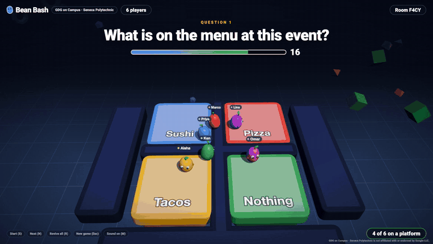

# Bean Bash



Full recording: [docs/demo.mp4](docs/demo.mp4).

A Fall Guys–style trivia game for our events. The projector shows a 3D arena; the audience joins on their phones by scanning a QR code. Each question, you drag your bean onto one of four answer platforms before the timer ends. The wrong platforms drop away and those beans fall. Last bean standing wins.

One round type, on purpose. Nobody needs instructions, and a new group can be playing within a minute.

**Host from <https://gdg-bean-bash.advancelabs.workers.dev/arena.html>** — use this exact URL, full-screen, on the laptop driving the projector.

Players join at **<https://gdg.runs-on.dev>** (or the same workers.dev domain, `/`) — the arena's QR code and join link already point at the right place, so nobody needs to type a URL.

`gdg.runs-on.dev` is a friendly redirect (via Advance Labs' [runs-on.dev](https://runs-on.dev)) to the deployment above, but it **only redirects the bare root** — it can't reach `/arena.html` or `/screen.html`, and it drops query strings (so `?room=CODE` links don't survive it either). That's a deliberate limitation of runs-on.dev's registry, not a bug: a claimed name redirects exactly one URL, nothing path-aware. Always use the workers.dev URL directly for hosting or for a specific room link; use `gdg.runs-on.dev` only as the memorable "type this in your phone's browser" fallback for the plain join screen.

Colors, typography, and the GDG attribution/disclaimer footer on every screen follow the [GDG on Campus brand kit](https://github.com/GDG-on-Campus-Seneca-Polytechnic/gdgSen-info/tree/main/guides/gdg-brand-kit).

## Running the night of the event

1. Open the arena page on the laptop driving the projector and put it full screen.
2. The page shows a QR code and a 4-letter room code. Leave it up while people arrive and eat.
3. Press **S** to start. Questions last 20 seconds, then a 6-second reveal.
4. Keep the browser tab open. Reloading is safe (the room is in the URL), but closing it ends the room.

Host keys on the arena page:

| Key | What it does |
| --- | --- |
| `S` | Start a game |
| `N` or space | Skip to the next question |
| `R` | Revive everyone, so knocked-out players are back in |
| `Esc` | New game, back to the lobby, and clears out players who have left |
| `M` | Mute or unmute the sound |

The same buttons are along the bottom of the screen if you'd rather click.

**Music.** A four-bar loop plays under everything: calm in the lobby, faster with drums while a question is running, and it dips under the fanfares and the platform collapse. It starts on the first press of **S** along with the rest of the audio, and **M** mutes it too.

**Sound.** The arena plays its own sound effects: a blip when someone joins, a fanfare when a question starts, a countdown in the last 5 seconds, a rumble as the wrong platforms drop, and a win or wipeout sting at the end. Plug the laptop into the room speakers. Browsers only allow sound after a click, so the first press of **S** switches it on. Press **M** or the Sound button to mute; the choice is remembered on that laptop. Phones stay silent on purpose, so 20 phones don't blare at once.

**Joining.** Scanning the QR opens the join page with the room already filled in. Everyone types a name and picks one of eight bean colours, then joins. Names are unique per room: if two people pick "Sam", the second becomes "Sam 2" and their phone tells them so. While playing, the top of each phone shows that player's bean, name and score, so they can find themselves on the big screen.

**Leaving.** A phone that disconnects gets 30 seconds to come back, because locked screens and reloads happen all the time. After that its bean is removed. Players can also tap **Leave game** in the waiting room to go right away. Pressing **Esc** (New game) clears out everyone who is disconnected at that moment, so do that just before the real game to start with a clean room. Anyone who leaves and comes back later keeps tonight's points.

**Scoring.** A right answer is worth 500 points, plus up to 500 more for getting onto the platform early (it counts from the last time you moved). The last beans standing get a 500-point bonus. The leaderboard shows on the right after every reveal and on the final screen. Between games, the lobby shows **tonight's top beans**: totals across every game in that room, which is handy for handing out a prize at the end. Starting a new room resets them.

**Run it in short bursts.** Eight to ten questions takes about eight minutes. Run a game while people arrive, another after the team intros, and a final one for a prize. Anyone who arrives mid-game is marked as waiting and joins the next one.

## Editing the questions

Change the questions on the arena page itself. No file edits, no redeploy.

1. In the lobby, click **Questions** in the bottom bar. The editor lists the room's current set, with the correct answers marked.
2. Edit a question's text or its four answers, and pick the correct one with the **Correct** radio. Add, delete, move up or down, or shuffle. Every game shuffles the questions anyway.
3. Click **Save**. The room uses the new set from the next game.

The editor shows the correct answers, so edit before the audience can see the projector. It only opens in the lobby, and the room refuses changes mid-game.

Limits: 1 to 50 questions, question text up to 140 characters, exactly four answers of up to 40 characters each. The editor and the room both check this and say what's wrong.

The saved set is also kept in that laptop's browser, so the next room you open on it starts with the same questions. To move a set to another laptop, use **Export** (downloads `bean-bash-questions.json`) and **Import** on the other one, then Save. **Reset to the built-in questions** and Save goes back to the default set and forgets the saved copy.

The built-in set in [`src/questions.json`](src/questions.json) is only the default. Change it there if you want a different default for every laptop, then redeploy. Each question has the text, four answers, and `correct` as the index of the right answer (0 is the first answer, 3 is the last). Export and Import use the same format.

```json
{
  "text": "What does the 'G' in GDG stand for?",
  "answers": ["Great", "Google", "Global", "Graduate"],
  "correct": 1
}
```

Keep answers short: they are printed on the platforms, and long ones wrap onto two smaller lines. Mix easy and silly ones so students who don't code still have fun.

## Running it on your own machine

```bash
npx wrangler dev
```

Then open `http://localhost:8787/arena.html` for the screen and `http://localhost:8787/` for a phone. Phones on other devices can't reach `localhost`, so test a real crowd against the deployed version.

## Deploying

The game runs on Cloudflare Workers, which is free at our size. First time on a new machine:

```bash
npx wrangler login
```

Then, from this folder:

```bash
npx wrangler deploy
```

Wrangler prints the URL — it's tied to whichever Cloudflare account is logged in (each account has its own `*.workers.dev` subdomain), so deploying from a new machine/account gives a new URL, not an update to the old one. If that happens, update the `gdg.runs-on.dev` redirect at [runs-on.dev/manage](https://runs-on.dev/manage) (or edit `domains/gdg.json` in the [runs-on.dev repo](https://github.com/zordhalo/runs-on.dev)) so the QR code keeps working without reprinting anything.

## How it works

| Piece | What it does |
| --- | --- |
| `src/server.js` | The room. One Durable Object per room code, holding players, the current question, and the timer. It is the only thing that decides who is knocked out. |
| `public/arena.html`, `public/arena.js` | The projector view. 3D arena, beans, QR code, host controls. |
| `public/index.html`, `public/phone.js` | The phone. Join, pick a colour, drag your bean. |
| `public/audio.js` | The sound effects and the background music, synthesised in the browser. No audio files, nothing to download. |
| `public/screen.html`, `public/screen.js` | A flat 2D version of the screen. Backup if 3D misbehaves on the venue laptop. |
| `src/questions.json` | The built-in questions, used until the host saves a set in the editor. |
| `public/question-editor.js`, `public/question-rules.js` | The arena's question editor, and the rules a question set must follow (shared by the editor and the room). |

Phones send where their bean is standing, ten times a second. The server works out which platform that is, and the correct answer never reaches the phones until the reveal, so nobody can peek by opening the developer console. Only the host's arena page, which holds the room's host key, can read or change the question set.

## If something goes wrong

- **Phones can't join.** Check that the QR code points at the deployed URL and not at `localhost`.
- **The 3D arena is slow on the venue laptop.** Use `/screen.html` instead. Same game, flat 2D, much lighter.
- **Everyone is knocked out at once.** Press `R` to revive them all and keep going.
- **No sound.** Press **S** once (browsers block sound until a click), check the Sound button in the corner does not say "Sound off", and check the laptop's own volume and output device.
- **The whole thing misbehaves.** Have a Kahoot with the same questions ready and switch. Nobody will mind.
